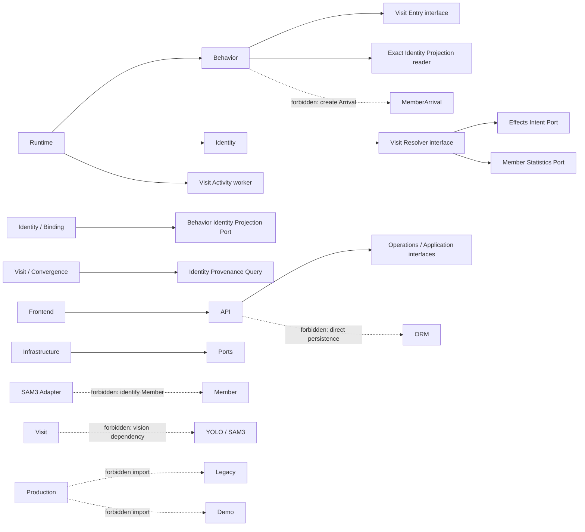

# Module Dependency Rules v2

## 1. 基本规则

- 一级先按 Business Capability，再在模块内部使用 Domain/Application/Ports/Adapters。
- Domain 依赖稳定值对象；Application 依赖 Port；Adapter 实现 Port 并依赖外部库。
- 跨 capability 依赖必须穿过消费方所需的窄 Interface，不能共享 ORM Model 作为长期接口。
- 当前 `agent.models` 是受保护的过渡实现，不是目标依赖方向。
- Runtime 可以构造模块，但不能拥有模块的业务决策。

## 2. 允许依赖矩阵

| From | May depend on | Must not depend on |
| --- | --- | --- |
| `runtime` | application runtime factories、runtime/platform | Behavior/Identity/Visit domain internals、Demo、Legacy |
| `identity/recognition` | mapping/store-resolution ports、Inbox repository | Visit mutation、Effects、Behavior rules |
| `identity/track_association` | Identity-owned Track snapshot sink/query、Face Spatial、policy/evaluation repository；Behavior 只提供 Person observation | Durable Binding mutation、Arrival、Profile |
| `identity/binding` | Evaluation read、Visit provenance read、Behavior identity projection port、exact Cache adapter | Visit merge、Member statistics、SAM3 |
| `behavior` | local tracking/rule/event interfaces、Visit Entry command、exact Identity Projection reader | Arrival/Effect creation、Binding mutation、Member inference |
| `visit/entry` | CustomerEntryObservation、Visit repositories、exact Cache reader、activity contract | Member lookup fallback、Binding/Job writes、Arrival creation |
| `visit/resolver` | recognition/evaluation input、Visit modules、Effects Intent port、Member Statistics port、Lease Context | camera/model adapters、Effect consumer |
| `visit/convergence` | Visit Merge interface、Identity Binding Provenance Query | Binding/Finalization mutation、Cache rewrite |
| `visit/activity` | exact confirmed projection input、Visit core/repository | Binding heartbeat、Visit close/merge、Arrival |
| `member` | Member repositories、Identity/Camera device-sync port、Effective Arrival read port | Visit lifecycle decision、vendor SDK directly |
| `effects` | MemberArrival facts、external executor ports | Inbox/Binding/Visit decisions |
| `profile` | explicit profile job、effective Arrival/Effect read interfaces | Inbox `processed`、Track identity decision |
| `evidence` | recording/capture/storage adapters、fact references | behavior/identity decisions |
| `operations` | read-only query ports | business fact mutation |
| `api` | application command/query interfaces and DTO | ORM Session/Model、camera stream |
| `infrastructure` | capability-owned ports、SQLAlchemy/vendor/filesystem libraries | production business policy |

## 3. 跨能力 Port

### Identity Binding -> Behavior

`identity/binding` 编排 applied Binding 后调用 Behavior-owned
`BehaviorIdentityProjectionPort.attach_exact_binding(...)`。Behavior 负责可写行的范围、
幂等和 provenance conflict。Identity 不能直接定义 BehaviorEvent 的业务语义。

### Visit Convergence -> Identity Binding

`visit/convergence` 定义它所需的只读
`IdentityBindingProvenanceQuery.references_any(visit_ids)`；Identity adapter 查询任何
Finalization Job 或 Binding 引用。返回命中时 Visit 必须阻断收敛。该 Port 不暴露
update/delete/recanonicalize 方法。

### Behavior -> Visit Entry

Behavior Entry 只提交 `CustomerEntryObservation`。Visit Entry 创建
`CustomerEntryEvent`、`VisitEntryEvidence` 和 Visit。Recognition-first/Entry-later 的
窄复用只消费 exact active confirmed Cache，并在事务内重验 Canonical Visit；它不获得
Member Association 权限。

### Visit -> Effects / Member

Resolver 在自己的 fenced transaction 中通过 `EffectIntentRepository` 记录 Intent，
并通过 `MemberStatisticsPort` 重算统计。Effects consumer 和 Member 实现不能反向决定
Visit canonicalization。

## 4. 依赖图与禁止边

## 5. 事实写入权限

- `MemberArrival`：仅 `visit/resolver` 可创建；`visit/merge` 可收敛/supersede；显式
  audit repair tool 可在人工授权下修复。Behavior、Identity、Effects、Member 均不能创建。
- `TrackIdentityBinding` 和 `TrackAssociationFinalizationJob`：仅
  `identity/binding` application 写入。Runtime 只启动 worker。
- `TrackAssociationEvaluation`：仅 `identity/track_association` audit application 创建，
  创建后 immutable。
- `BehaviorEvent`：仅 `behavior/events` 创建或按 exact Binding backfill。
- `Visit`：仅 Visit Entry、Resolver、Merge/Convergence 和 Activity 按各自窄权限更新。

## 6. 明确禁止

- Behavior 或 SAM3 创建/修改 Member、Visit、Arrival、Effect、Binding。
- Visit 导入 YOLO、ByteTrack、SAM3 或 camera vendor SDK。
- Identity Binding 重写 Canonical Visit 或 Phase 2C history。
- Phase 2C 修改 Evaluation、Finalization Job、Binding 或 Cache provenance。
- API route 打开 Session 或查询 ORM。
- Profile 把 Recognition Inbox 状态当作到店事实。
- Production import Demo/Legacy。当前 eager import 是债务，不是允许的例外。
- 新代码使用 `phase2a/phase2b/phase2c/phase2d` 作为业务 package。

## 7. Phase 2D 修改范围

PoC 合格并冻结合同后，Phase 2D 默认只允许修改：

- `behavior/merchandise/*` 及其 tests；
- Behavior runtime 的 Adapter 注入点；
- `behavior/events` 的最小事件表达；
- 必要的 infrastructure model/config adapter；
- 后续单独授权的 Operations/API read model。

默认禁止修改：Identity recognition/association/binding、Visit resolver/convergence/merge/
activity、MemberArrival、Effects ledger、StoreRuntime lease/fatal supervision、Production Gate、
既有数据库 Schema。Schema 只有在 BehaviorEvent 无法表达 PoC 已证明的事实且单独评审后
才能演进。
