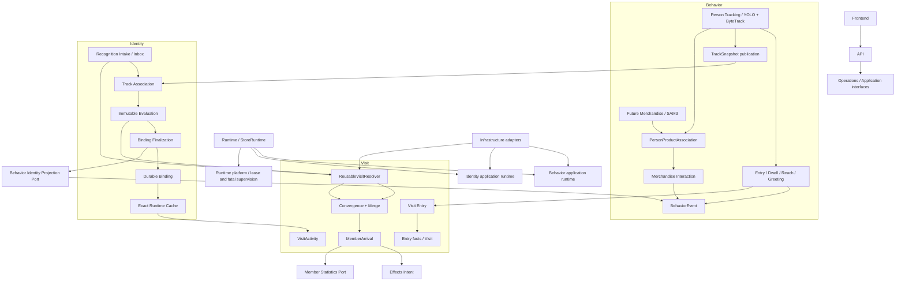

# RetailVision Project Module Architecture v2

状态：`FROZEN_LOGICAL_ARCHITECTURE`。基线代码：`e93dfdd` 及当前工作树。完整真实
Phase 2A-2C E2E 尚未完成，因此本文件只冻结逻辑模块和接口，不冻结物理路径。

## 1. 架构中心

RetailVision 的核心问题被分成四类：

- `WHO / WHICH PERSON`：Identity；
- `WHAT IS HAPPENING`：Behavior；
- `WHICH VISIT`：Visit；
- `WHAT BUSINESS ACTION FOLLOWS`：Effects。

Runtime 只组合和监督这些模块。Member 提供独立会员主体。Evidence 提供可审计
视频证据。Operations 和 API 只暴露读模型与命令接口。

## 2. 一级模块

| 一级模块 | 负责 | 不负责 |
| --- | --- | --- |
| `runtime` | Store Composition Root、Store Lease、`runtime_instance_id`、fatal supervisor、shutdown barrier | Identity policy、Behavior rule、Visit merge |
| `identity` | Device Recognition、Member Mapping、Store/Camera mapping、Person Track Association、Durable Binding | Person tracking、Visit lifecycle、Effects execution |
| `behavior` | 视频中的 Person Track、role、Entry visual observation、dwell、reach、greeting、BehaviorEvent；未来 merchandise vision | Member identity decision、MemberArrival、Visit canonicalization |
| `visit` | Entry facts、Visit lifecycle、Recognition Resolver、Canonical convergence/merge、MemberArrival、VisitActivity | YOLO/SAM3、Binding mutation、external effects |
| `member` | Member、tier、priority、management、device sync、由 Effective Arrival 派生的统计 | Visit lifecycle 和 Arrival 判定 |
| `effects` | MemberArrivalEffect Intent、claim/ACK/fail、未来外部 consumer | Recognition acceptance、Visit/Binding decision |
| `evidence` | Device Recording、EvidenceClip、capture、review evidence | Track Association 或行为结论 |
| `profile` | Profile job、LLM/model analysis、profile snapshot | 以 Inbox `processed` 推断到店事实 |
| `operations` | health、audit、diagnostics、metrics、read model | 业务事实写入 |
| `api` | HTTP transport、DTO、application command/query adapter | ORM Session、业务事务、摄像头流 |
| `infrastructure` | SQLAlchemy/SQLite、schema evolution、config、camera/filesystem/model adapters | 业务决策所有权 |
| `legacy` | 旧 Entry/Identity/SimpleTracker/MemberBusiness 兼容链 | 被 new StoreRuntime 生产链加载 |
| `demo` / `tools` | 演示和显式开发/诊断命令 | 成为生产 writer 或 import side effect |

Frontend 是 API client，不是后端业务模块。

## 3. 目标逻辑树

```text
runtime/
  application/              Store composition and supervision
  platform/                 lease, activation, runtime instance

identity/
  recognition/              intake, inbox, mapping, health, store resolution
  track_association/         snapshots, candidates, spatial assessment, evaluation, policy
  binding/                   finalization, durable binding, cache projection, heartbeat

behavior/
  application/runtime/
  tracking/                 Person Track contracts and YOLO/ByteTrack adapter
  role/
  entry/                    visual observation only
  dwell/
  reach/
  greeting/
  events/
  merchandise/              Future Phase 2D only
    tracking/               MerchandiseObservation and SAM3 adapter
    association/            PersonProductAssociation
    interaction/            pickup_candidate/pickup/holding/put_back

visit/
  core/
  entry/
  resolver/
  convergence/
  merge/
  arrival/
  activity/
  projection/

member/  effects/  evidence/  profile/  operations/  api/  infrastructure/
legacy/  demo/  tools/  frontend/
```

`convergence` 是 Phase 2C application use case；它复用 `merge` 的
audit-preserving 实现。两者应保持不同接口，不应复制 Canonical 选择或事实迁移规则。

## 4. 当前生产调用图



## 5. 事实与业务决策

- Person Track 属于 `behavior/tracking`。`track_token` 是一次 StoreRuntime 内的
  Person Track 完整 scope，不是 Member identity。
- Member Identity 的 intake、assessment 和 application 属于 `identity`。
- Visit 和 MemberArrival 属于 `visit`；只有 Visit application 可以决定或收敛。
- BehaviorEvent 属于 `behavior/events`，可以匿名，也可附加 exact Binding provenance。
- SAM3 将来只是 `behavior/merchandise/tracking` 的 Adapter。
- Person/Product 关联属于 `behavior/merchandise/association`。
- pickup、holding、put_back 状态机属于 `behavior/merchandise/interaction`。

## 6. 关键接口

| 模块 | 推荐外部接口 | 隐藏的复杂性 |
| --- | --- | --- |
| Behavior Tracking | `observe(frame) -> PersonObservation[]` | YOLO、ByteTrack、role-independent track lifecycle |
| Track Association | `assess(request) -> Assessment` | Event Time window、Primary Snapshot、Face Spatial、ambiguity |
| Identity Binding | `finalize(job)` / exact projection query | recovery、conflict、unique fence、heartbeat、fail-stop |
| Visit Entry | `confirm_entry(observation) -> VisitEntryResult` | replay、entry evidence、anonymous creation、Phase 2C narrow reuse |
| Visit Resolver | `resolve(recognition) -> Result` | one fenced transaction、reuse、convergence、Arrival、Effect Intent |
| Visit Merge | `preview/merge(candidate_ids)` | canonical selection、fact movement、Arrival/Effect convergence |
| Behavior Events | `record(event)` / `attach_identity(binding)` | idempotency、provenance conflict、bounded backfill |
| Effects | `record_intent` and `claim/ack/fail` | same-transaction intent、external idempotency |

## 7. 当前最大 God Modules

1. `agent/reusable_visit_resolver.py`：一个事务中同时编排 Recognition、Visit、
   Phase 2C、Arrival、Effect Intent、Member statistics 和 Finalization Job。
2. `agent/track_association_finalization.py`：Finalization application、cache projection、
   Behavior backfill orchestration 和 Binding heartbeat 共存。
3. `pipelines/store_runtime.py`：dependency construction、lease lifecycle、worker ownership、
   fatal supervision 和 shutdown 都在同一实现。
4. `pipelines/device_identity_runtime.py`：new Identity lifecycle 与 Legacy runtime branch
   共享 import graph。
5. `agent/models.py`：所有 capability 的 ORM facts 和 indexes 集中，是最大迁移耦合点。

这些文件未来需要按接口深化后拆分，当前不得物理移动。

## 8. v1 结论状态

| v1 内容 | v2 状态 | 原因 |
| --- | --- | --- |
| Business Capability First | `STILL_VALID` | 长期模块不按技术层或 Phase 划分 |
| Behavior 不创建 Arrival | `STILL_VALID` | ADR/代码事实所有权未改变 |
| API 不直接访问 ORM | `STILL_VALID_TARGET` | 目标仍正确，当前 `member_api` 仍有 composition debt |
| No Phase 2B capability | `SUPERSEDED` | Phase 2B Step 1-4 已实现 |
| Binding 属于 Track Association 的 future seam | `SUPERSEDED` | v2 将 durable application 明确为 `identity/binding` |
| CustomerEntryVisit 只写匿名 Visit | `SUPERSEDED_NARROWLY` | ADR 0005/0020 允许 exact confirmed Cache 复用既有 Member Visit |
| VisitActivity 为 reserved Phase 2B | `SUPERSEDED` | Step 4 已实现且由 StoreRuntime 组合 |
| Stage D/E 物理拆分 | `NEEDS_UPDATE` | 仍被 E2E 阻塞，且必须纳入 Phase 2B/2C 新依赖 |

## 9. 为什么 Phase 不是 Module

Phase 是交付时间线；Module 是长期稳定的业务决策所有权。Phase 2B 同时交付
Identity Binding、Behavior Backfill、Runtime supervision 和 VisitActivity。如果建立
`phase2b/`，同一个业务事实会按开发日期被拆散，后续调用者必须理解历史计划而不是
接口。v2 只把 Phase 保留为 provenance 和测试分组，不作为 package 名称。

